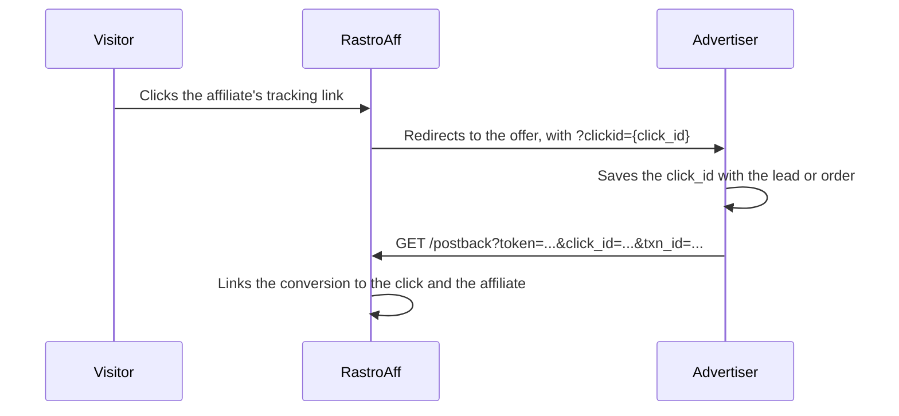

# RastroAff integration examples

Copy-paste examples for sending conversions to [RastroAff](https://rastroaff.com), the affiliate tracking platform for networks, brands and iGaming operators, and for receiving them as an affiliate.

Every example uses only the standard library of its language. Replace the values in `CAPITALS` with your own.

| Folder | For whom | What it shows |
|---|---|---|
| [`landing-page/`](landing-page) | Advertiser | Keep the `click_id` from the landing page until the conversion |
| [`advertiser-postback/`](advertiser-postback) | Advertiser | Server-to-server (S2S) postback in cURL, Node.js, Python and PHP |
| [`conversions-api/`](conversions-api) | Advertiser | The same conversion through the REST API, with an API key |
| [`affiliate-postback-receiver/`](affiliate-postback-receiver) | Affiliate | Receive RastroAff postbacks in your own server or tracker |
| [`MACROS.md`](MACROS.md) | Network | Macros from Everflow, Affise, Scaleo and Offer18 and their RastroAff equivalents |

## How S2S tracking works



No cookies or browser scripts are involved, so ad blockers and privacy settings don't break attribution.

## The postback URL

Each advertiser has a URL with a secret token. Find it on the advertiser's page in RastroAff (or on the **Integration** page, if the advertiser has panel access).

```
https://TRACKING_DOMAIN/postback?token=ADVERTISER_TOKEN&click_id=CLICK_ID&txn_id=ORDER_ID&amount=49.90&status=approved
```

| Parameter | Required | What it does |
|---|---|---|
| `token` | yes | Identifies the advertiser. Keep it secret. |
| `click_id` | yes* | The identifier received in the destination URL. |
| `txn_id` | recommended | The order or lead ID. Without it, each click can only produce one conversion. |
| `amount` | for CPS | Sale value, used for percentage payouts. |
| `status` | no | `approved`, `pending`, `rejected` or `reversed`. |
| `goal` | no | A campaign goal with its own payout, for example `first_deposit`. |
| `coupon` | no | Attributes by coupon code instead of `click_id` (`txn_id` then required). |
| `country` | no | The customer's country (ISO 3166-1 alpha-2). Helps fraud checks. |
| `customer_id` | no | For subscriptions: renewals can then be sent with `customer_id` alone. |
| `interval` | no | `month`, `quarter` or `year`, for recurring payments. |

\* Not needed when the conversion is attributed by `coupon`.

To change a conversion's status (refunds, chargebacks), send the postback again with the **same `click_id` and `txn_id`** and the new status.

## Test before going live

- Paste your postback URL in the free [postback URL checker](https://rastroaff.com/tools/postback-url-checker): it flags missing parameters and unreplaced macros.
- Make a test click, then open the postback URL with that `click_id`. The conversion shows up in **Conversions** within seconds. If it doesn't, search the `click_id` in **Clicks** to see the reason.

## Guides

- [Advertiser postback (S2S)](https://rastroaff.com/guides/advertiser-postback)
- [Affiliate postbacks to your tracker](https://rastroaff.com/guides/affiliate-postback)
- [Postback macros](https://rastroaff.com/guides/postback-macros)
- [Postback troubleshooting](https://rastroaff.com/guides/postback-troubleshooting)
- [REST API](https://rastroaff.com/guides/rest-api)
- [Migrate from Everflow, Affise, Scaleo or Offer18](https://rastroaff.com/migrate)

## License

MIT. See [LICENSE](LICENSE).
